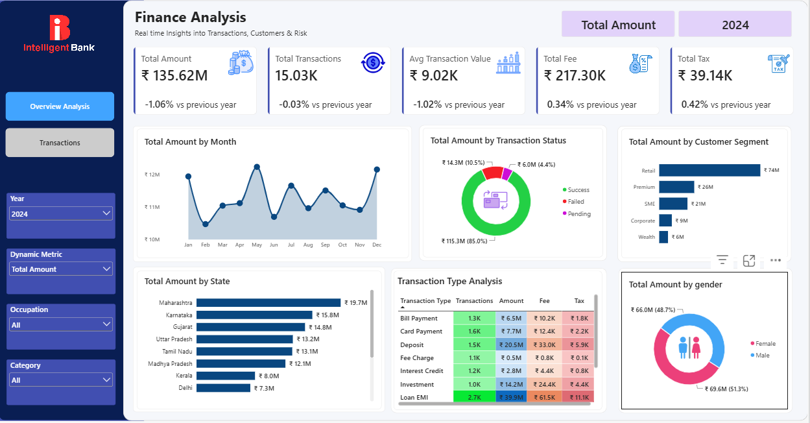

# 🏦 Intelligent Bank – Finance Analysis Dashboard

An interactive **Power BI Finance Analysis Dashboard** designed to analyze banking transactions, customer segments, transaction patterns, and financial performance. This project provides a comprehensive overview of key financial metrics through interactive visualizations, allowing users to explore transaction data and identify meaningful business insights.

## 📊 Dashboard Preview

## 🎯 Project Overview

The Intelligent Bank Finance Analysis Dashboard focuses on analyzing financial transactions and monitoring the bank's overall financial performance.

The dashboard enables users to track important financial indicators, compare yearly performance, understand customer behavior, and evaluate transaction patterns across different categories.

It provides an interactive reporting experience through dynamic metrics, filters, and multiple visualizations.

## 📌 Key Performance Indicators (KPIs)

The dashboard highlights five major financial indicators:

| KPI | Description |
|---|---|
| **Total Amount** | Total monetary value of transactions. |
| **Total Transactions** | Total number of transactions recorded. |
| **Average Transaction Value** | Average monetary value per transaction. |
| **Total Fee** | Total fees generated from transactions. |
| **Total Tax** | Total tax associated with transactions. |

Each KPI also displays a percentage comparison against the previous year to help monitor changes in financial performance.

## 📈 Dashboard Visualizations

The dashboard includes the following visualizations:

### 1. Total Amount by Month
- Displays monthly transaction amounts.
- Helps identify monthly trends and fluctuations.
- Provides an overview of transaction activity throughout the year.

### 2. Total Amount by Transaction Status
- Categorizes transactions into Success, Failed, and Pending.
- Displays the distribution of transaction amounts by status.
- Helps monitor transaction completion and failure patterns.

### 3. Total Amount by Customer Segment
- Compares transaction amounts across customer segments:
  - Retail
  - Premium
  - SME
  - Corporate
  - Wealth
- Identifies the customer segments contributing the most transaction value.

### 4. Total Amount by State
- Displays transaction amounts across different Indian states.
- Helps identify geographical distribution and regional financial activity.

### 5. Transaction Type Analysis
A detailed breakdown of different transaction types, including:
- Bill Payment
- Card Payment
- Deposit
- Fee Charge
- Interest Credit
- Investment
- Loan EMI

The analysis includes:
- Number of transactions
- Transaction amount
- Transaction fees
- Transaction taxes

### 6. Total Amount by Gender
- Compares transaction amounts between male and female customers.
- Displays the percentage contribution of each gender to the total transaction amount.

## 🎛️ Interactive Filters

The dashboard provides interactive slicers to explore financial data from different perspectives.

- **Year:** Filter transactions by year.
- **Dynamic Metric:** Switch between available financial measures.
- **Occupation:** Analyze transaction activity based on customer occupation.
- **Category:** Filter data by transaction category.

These filters allow users to customize the analysis and explore specific segments of the dataset.

## 🛠️ Tools & Technologies

- **Microsoft Power BI Desktop** – Dashboard development and data visualization.
- **Power Query** – Data cleaning and transformation.
- **DAX (Data Analysis Expressions)** – Calculated measures, KPIs, and dynamic metrics.
- **Data Visualization** – Interactive charts, graphs, tables, and slicers.

## 💡 Key Business Insights

The dashboard helps stakeholders:

- Monitor overall financial performance.
- Identify monthly transaction trends.
- Evaluate successful, failed, and pending transactions.
- Understand customer segment contributions.
- Compare transaction activity across geographical regions.
- Analyze transaction types, fees, and taxes.
- Explore customer transaction behavior by gender and occupation.
- Compare financial performance with the previous year.

## 🚀 How to Explore the Project

1. Clone or download this repository.
2. Install [Microsoft Power BI Desktop](https://www.microsoft.com/en-us/power-platform/products/power-bi/desktop).
3. Open the `.pbix` file using Power BI Desktop.
4. Interact with the dashboard using the available slicers and filters.
5. Explore the visualizations to understand different aspects of financial performance.

## 👨‍💻 Author

**Bibek Bist**

Aspiring Data Analyst | Power BI | SQL | Python | Tableau | Advanced Excel

---

⭐ If you find this project interesting, consider giving this repository a star!
